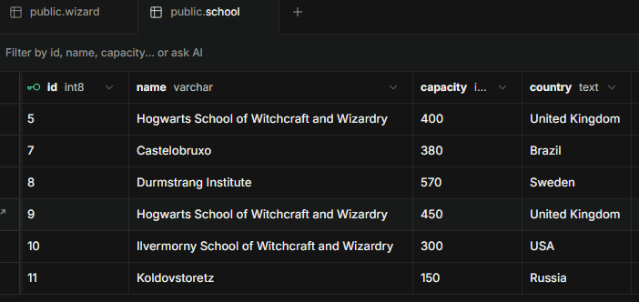
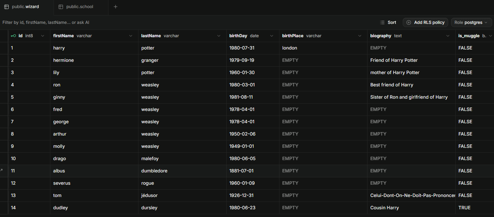

**Pour le Brief SQL - Intro et premières requêtes**

Je n'avais pas enregistrer mon travail quelques part, mais il est bien effectuer sur supabase.

Ma seul ligne de code enregistrer est un bout de l'exercice : MySQL 03 - Manipulation des données.

`select "birthDay" wizard where "birthDay" between "1975" and "1985";`

Il y a mon MCD fait sur excalidraw: je n'est pas capter encore la cardinalité donc je n'est pas reussit a le faire je sais juste que il y a un N/0 quelques part.

[Supabase](https://supabase.com/dashboard/project/kuycbfuartnvywqbttgd)
